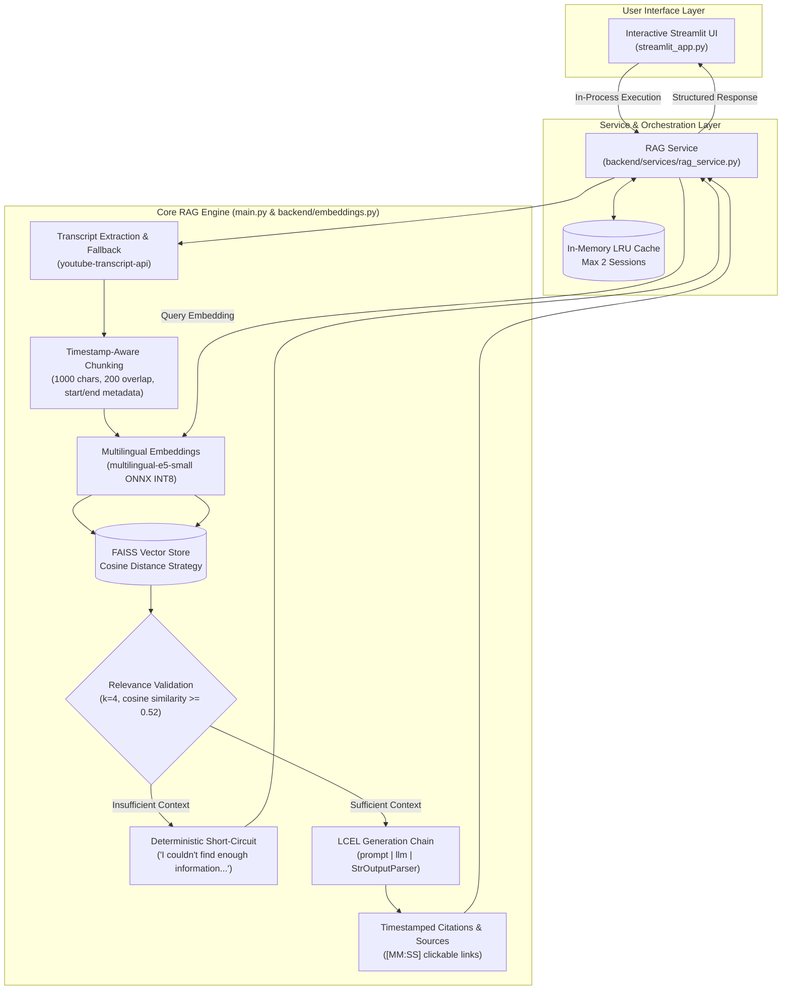

# AskTube — YouTube Video Q&A with Grounded RAG

Ask questions about any YouTube video and receive accurate, grounded answers backed by timestamped citations.

[](https://www.python.org/)
[](https://streamlit.io/)
[](https://www.langchain.com/)
[](https://onnxruntime.ai/)
[](https://github.com/facebookresearch/faiss)
[](https://opensource.org/licenses/MIT)

---

## 🏛️ System Architecture

AskTube is designed as a standalone AI/ML and Generative AI application featuring an interactive Streamlit interface backed by a modular, in-process RAG pipeline:



### Architectural Components

1. **Streamlit Application (`streamlit_app.py`):** The primary user interface. Features responsive video playback, collapsible transcript explorer, conversation history, clickable timestamp citations, and real-time session controls.
2. **RAG Service Layer (`backend/services/rag_service.py`):** Coordinates bounded in-memory LRU session state (capped at 2 active video sessions to prevent memory leaks), on-disk FAISS index caching (`.rag_cache/`), and unified retrieval/generation dispatch.
3. **Core RAG Engine (`main.py`):** Implements transcript ingestion with multi-language fallback, timestamp-aware text chunking (1000 chars with 200 overlap), FAISS vector store indexing, cosine similarity relevance scoring, and LCEL-based grounded answer synthesis.
4. **PyTorch-Free Embedding Engine (`backend/embeddings.py`):** Custom ONNX Runtime INT8 implementation of `intfloat/multilingual-e5-small`. Uses Hugging Face Rust tokenizers and ONNX Runtime CPU to deliver multilingual embeddings (English, Hindi, and 100+ languages) without PyTorch overhead.

---

## ✨ Core Features

* **Strict Transcript Grounding & Deterministic Short-Circuit:** The LLM is strictly constrained to synthesize answers only from retrieved transcript context. If retrieved passages do not satisfy the relevance threshold (cosine similarity >= 0.52, equivalent to cosine distance <= 0.48), AskTube immediately returns `"I couldn't find enough information in the transcript."` without calling the LLM.
* **Timestamp-Aware Citations:** Every retrieved text chunk retains exact start and end timestamps, generating clickable `[MM:SS]` citations linking directly to that moment in the video.
* **Lightweight Multilingual Embeddings:** Uses `intfloat/multilingual-e5-small-onnx-int8` (quantized ONNX runtime + Rust tokenizers), avoiding PyTorch to keep memory consumption under ~135 MB while supporting English, Hindi, and 100+ other languages.
* **LCEL Generation Chain:** Clean LangChain Expression Language generation pipeline (`prompt | llm | StrOutputParser()`) using `Qwen/Qwen3-8B` via Hugging Face Serverless Inference.
* **Bounded Caching:** FAISS vector stores are cached in session memory using a thread-safe LRU cache (capped at 2 active sessions) and persisted on disk (`.rag_cache/`) to avoid redundant re-embedding.

---

## 🛠️ Tech Stack

* **Application Interface:** Streamlit (`streamlit_app.py`)
* **RAG Orchestration:** LangChain LCEL (`langchain-core`, `langchain-huggingface`)
* **Vector Index:** FAISS (`faiss-cpu`, cosine distance strategy)
* **Embeddings:** `intfloat/multilingual-e5-small-onnx-int8` via `onnxruntime` and `tokenizers`
* **LLM:** `Qwen/Qwen3-8B` via Hugging Face Serverless Inference API
* **Transcript Extraction:** `youtube-transcript-api` (with automated multi-language fallback)
* **Data Schemas:** Pydantic (`backend/schemas.py`)

---

## ⚙️ How It Works

1. **Video Ingestion & Validation:** Validates YouTube URLs (standard watch, Shorts, embed, youtu.be) and extracts the 11-character video ID. Retrieves video titles via YouTube oEmbed without requiring a YouTube Data API key.
2. **Transcript Acquisition & Fallback:** Fetches subtitles via `youtube-transcript-api` using preferred language ranking (`en`, `hi`, etc.) and automatically falls back to any available manual or auto-generated transcript.
3. **Timestamp-Aware Chunking:** Groups transcript snippets into chunks of 1000 characters with 200 character overlap, preserving exact start and end timestamps.
4. **Multilingual Vector Indexing:** Formats passages with the E5 prefix convention (`passage: <text>`), generates 384-dimensional normalized embeddings using ONNX Runtime INT8, and builds a FAISS index with cosine distance.
5. **Retrieval & Relevance Validation:** Formats user questions with the query prefix (`query: <question>`), retrieves the top-4 chunks, and filters them against a calibrated relevance score threshold of at least 0.52 cosine similarity (equivalent to cosine distance <= 0.48).
6. **LCEL Generation:** If relevant context exists, passes the grounded prompt to the LCEL chain (`prompt | llm | StrOutputParser()`). If context is insufficient, returns a deterministic fallback message with zero LLM invocation.
7. **Source Formatting:** Attaches chunk IDs, start timestamps, and direct video links to the response.

---

## 🚀 Local Setup & Execution

### 1. Clone Repository
```bash
git clone https://github.com/hitesh-2005/AskTube.git
cd AskTube
```

### 2. Create Virtual Environment
```bash
# Windows
python -m venv .venv
.venv\Scripts\activate

# Linux / macOS
python3 -m venv .venv
source .venv/bin/activate
```

### 3. Install Dependencies
```bash
# Install all application dependencies
pip install -r requirements.txt

# (Optional) Install testing tools
pip install -r requirements-dev.txt
```

### 4. Configure Environment
Create a `.env` file in the project root:
```env
HUGGINGFACEHUB_API_TOKEN=hf_your_token_here
EMBEDDING_MODEL=intfloat/multilingual-e5-small-onnx-int8
RELEVANCE_SCORE_THRESHOLD=0.52
RETRIEVER_K=4
CHUNK_SIZE=1000
CHUNK_OVERLAP=200
MAX_ACTIVE_SESSIONS=2
```

### 5. Launch Application
```bash
streamlit run streamlit_app.py
```
Open your browser at **`http://localhost:8501`** to interact with AskTube.

---

## 🧪 Verification & Tests

Run the complete test suite (101 passing tests):

```bash
pytest test_main.py tests/
```

### Test Breakdown

* **`test_main.py` (83 tests):** Core RAG pipeline, transcript retrieval, timestamp chunking, cosine similarity thresholding, disk caching (`v6`), YouTube URL extraction, and LCEL prompt formatting.
* **`tests/test_onnx_embeddings.py` (9 tests):** ONNX INT8 session options (memory arena disabled, thread bounds), E5 passage/query prefix formatting, and vector dimensionality.
* **`tests/test_streamlit_app.py` (9 tests):** Streamlit URL parsing, timestamp conversion, Hugging Face token resolution, and RAG dispatch routing.

---

## ☁️ Deployment (Streamlit Community Cloud)

To deploy AskTube to [Streamlit Community Cloud](https://share.streamlit.io/):

1. Push your repository to GitHub.
2. Connect your repository to Streamlit Community Cloud and select `streamlit_app.py` as the main entry point.
3. In **App Settings → Secrets**, add your Hugging Face API token:
   ```toml
   HUGGINGFACEHUB_API_TOKEN = "hf_your_token_here"
   ```
4. Deploy the application. Because the ONNX embedding engine runs without PyTorch, memory usage is well within Community Cloud limits.

---

## ⚠️ Known Limitations & Operational Notes

* **First-Run Model Download:** On the first execution, `ONNXE5Embeddings` automatically downloads the quantized INT8 model (~135 MB) and tokenizer from Hugging Face Hub. Downloaded files are cached locally in standard Hugging Face cache for subsequent instant startup.
* **YouTube Transcript Access:** YouTube occasionally restricts automated transcript requests from shared cloud IP ranges (e.g. data center IP blocks). AskTube handles these errors explicitly with clear status codes (`YOUTUBE_TRANSCRIPT_BLOCKED` and `TRANSCRIPT_UNAVAILABLE`).
* **Hugging Face Serverless Quotas:** LLM inference depends on Hugging Face Serverless free-tier capacity. If the shared demo rate limit is reached, users can supply their own free Hugging Face API token directly in the application sidebar.
